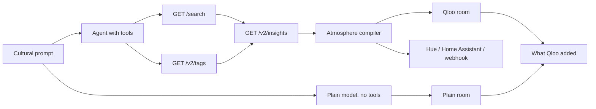

# Atrium

Atrium turns a cultural prompt into a room. Qloo's taste graph decides the lamps, the furniture, the poster, and the sound. A second model call, with no Qloo tools, draws the obvious cliché of the same prompt so the difference is visible.

The room is the product. Every light, object, and sound layer cites the Qloo entity or tag that earned it. Tap a lamp and the chip reads like: from Qloo tag "lo-fi" · affinity 0.82 · entity: Nujabes.



On Vercel, Production and Preview have `QLOO_API_KEY` and `OPENAI_API_KEY`. The designed path is the agent (`gpt-4.1-mini` choosing lookups) beside a plain `gpt-4.1-mini` room that never sees Qloo. Locally, with both keys empty, the same page runs a fixed lookup order and a labeled cliché. The badge says **Mock fixture** in that case. It never says the model key is missing.

The compiler is deterministic and validated with zod. The model does not author the room JSON. `compile_atmosphere` runs the compiler on the graph the tools returned.

## Who it is for

Someone setting a room at home, and the same idea for a bar, a restaurant, or a shop floor: name the taste, see the ambiance, then send the lamps to real lights.

## Run it

Node 22 or newer.

```bash
npm install
cp .env.example .env.local
npm run dev
```

Open [http://127.0.0.1:43123](http://127.0.0.1:43123). Leave the keys empty to use the labeled fixture graph. Set `QLOO_API_KEY` for live taste data and `OPENAI_API_KEY` for the agent and the plain-model comparison. `QLOO_MODE=auto` uses live Qloo when the key is present.

```bash
npm test
npm run lint
```

## Environment

| Variable | Required | Purpose |
| --- | --- | --- |
| `QLOO_API_KEY` | For live taste data | Hackathon key. Sent only as the `X-Api-Key` header, server-side. |
| `QLOO_API_URL` | No | Defaults to `https://hackathon.api.qloo.com`. |
| `QLOO_MODE` | No | `auto` (default), `mock`, or `live`. |
| `LLM_PROVIDER` | No | `openai`, `anthropic`, or `gateway`. |
| `LLM_MODEL` | No | Overrides the provider default. |
| `LLM_API_KEY` | No | Fallback key when the provider-specific variable is empty. |
| `OPENAI_API_KEY` | For the agent and the plain comparison | OpenAI. Default model `gpt-4.1-mini`. Set on Vercel Production and Preview. |
| `ANTHROPIC_API_KEY` | No | Anthropic. Default model `claude-sonnet-4-5`. |
| `AI_GATEWAY_API_KEY` | No | Vercel AI Gateway. Default model `openai/gpt-4.1-mini`. |
| `ATMOSPHERE_DISPATCH` | No | `off` (default), `webhook`, `hue`, or `home_assistant`. |
| `ATMOSPHERE_DISPATCH_AUTO` | No | `true` pushes the palette at the end of a compile. |
| `DISPATCH_WEBHOOK_URL` | For webhook | Public URL that accepts `POST` JSON. |
| `HUE_BRIDGE_HOST` | For Hue | Bridge host. Reachable only from the same LAN. |
| `HUE_USERNAME` | For Hue | Hue API username. |
| `HUE_GROUP_ID` | No | Group id, default `0` (all lights). |
| `HA_BASE_URL` | For Home Assistant | Base URL, no trailing path. |
| `HA_TOKEN` | For Home Assistant | Long-lived access token. |
| `HA_ENTITY_ID` | For Home Assistant | Light entity, for example `light.living_room`. |

## What Qloo is asked to do

The client does not call `/recommendations` or `/recs`.

1. `GET /search?query=` resolves names in the prompt to entity ids. The agent searches one to three names, then `select_seeds` keeps the ones that match the prompt.
2. `GET /v2/tags?filter.query=` resolves mood words to tag ids. Free text is never sent as a tag URN.
3. `GET /v2/insights` runs once per domain (`artist`, `place`, `brand`, `book`, `movie`, and `urn:tag`) with `signal.interests.entities`, `signal.interests.tags` when tags resolved, and `feature.explainability=true`.

Those domains fill different channels. Artists set the tempo and the records. Places set the counter and the furniture. Brands, books, and movies fill the shelf and the wall poster. Tag names pick a color family. A tag the family table does not know still becomes a lamp: its hue is a hash of the tag id, and the chip says so.

Auth is `X-Api-Key`. A 401 names the hackathon host. Personal data is not sent. The prompt is a cultural description, not a user profile. Results describe what groups tend to like.

The trace under the room lists each call and why it was made. When the model key is set, the line reads `{model} chose these Qloo calls.`

## Plain reading

The comparison is a second `generateText` with `Output.object` and no tools. It is allowed to be generic: cyan rain, a saxophone, pink symmetry, a cat. The card under the rooms lists names Qloo added that the plain side did not reach, and names both sides landed on.

On a phone, **Atrium** and **Plain LLM** switch the room. A swipe does the same. On a wide screen both rooms stay side by side.

With no model key, that side is a fixed cliché of the words in the prompt, and the note says so. The hosted app has the key, so judges see two model calls.

## A request, redacted

This walkthrough uses the labeled fixture graph, the stand-in checked into `lib/qloo/fixtures.ts`. Live responses are not stored in the repo. The call shape is the same against `https://hackathon.api.qloo.com`.

Prompt: `Blade Runner meets a 1970s jazz bar`.

1. Search resolves the film. Seeds are entity ids, not the raw sentence.
2. Tag search resolves mood words such as jazz. The client sends the returned tag id, not a URN built from the word.
3. Insights for `urn:entity:artist` returns neighbors such as Vangelis from the film and Miles Davis, Alice Coltrane, and Bill Evans from the jazz signal. Place insights return a venue such as Sodium Lamp Bar. Brand, book, and movie insights fill the other shelves.
4. The compiler paints a neon plan with a night city window. One lamp cites a neon tag. Another cites a jazz tag, so the room is not one cyan tube. The poster is drawn type for the film, not an entity photo. The bed is a pad, vinyl crackle from the jazz tag, and a pulse whose tempo is the weighted tag tempos.
5. The plain call, given only the sentence, reaches for cyan rain and an unnamed saxophone. The diff names Vangelis and the bar.

## Lights

**Send to my real lights** is the bridge from the virtual room to a room you can stand in. Dispatch stays off unless you opt in.

- **Webhook** works from a public deploy. The body is `{ event: "atrium.atmosphere", palette, tempoBpm, title, prompt, lights }`. `lights` is `{ id, label, color, intensity }[]`.
- **Philips Hue** `PUT`s `on`, `bri`, and `xy` to `/api/{username}/groups/{id}/action`. The bridge has to be on the same network as the Next.js server. A Vercel deployment cannot see `192.168.x.x`.
- **Home Assistant** `POST`s `/api/services/light/turn_on` with `rgb_color`. Use a URL the host can reach.

The button always says whether anything was sent. With dispatch off, it returns the payload it would have sent and does not call the network.

## Deploy

The demo is a public Vercel app, with no login.

1. Import the repo as a Next.js project.
2. Set `QLOO_API_KEY`, `QLOO_API_URL=https://hackathon.api.qloo.com`, and `QLOO_MODE=auto` for Production and Preview.
3. Set `OPENAI_API_KEY` for Production and Preview. The default model is `gpt-4.1-mini`.
4. Leave `ATMOSPHERE_DISPATCH=off` unless the target is a public webhook or a public Home Assistant URL.
5. Open a preview, type a prompt or use one of the four examples, and read the trace and the comparison.

`/api/compile` allows 30 requests per 10 minutes per IP, and 150 across everyone on that server instance. The agent and the plain model run in parallel. The route sets `maxDuration` to 60 seconds. The platform may cap a plan lower than that. `/api/dispatch` stays at 12 per 10 minutes per IP. The limiter is in memory, so it applies per instance. A request body cannot choose the webhook, Hue, or Home Assistant address. `QLOO_API_URL` has to be an `https` host under `qloo.com` or the key is not sent.

## Known limits

- The color prior is a table of tag-name stems. A miss still lights a lamp, hashed from the tag id, and the chip says there was no prior.
- The plain room is a live model only when a provider key is set. That key is set on Vercel Production and Preview. Local runs without it show the labeled cliché.
- Sound is synthesized in the browser: a pad, a texture (rain, vinyl, water, crowd, air, or steam), and a pulse. No recorded tracks.
- The poster is drawn type. Entity photos are not used as room art.
- Hue is LAN-only. A public demo should use a webhook or a public Home Assistant URL.
- Without `QLOO_API_KEY` the page uses the fixture graph and says **Mock fixture**.
- Do not send personal data. Prompts should describe a taste, not a person.

## Project layout

- `lib/qloo` live client, fixture client, response parsing
- `lib/agent` query splitting, deterministic gather, AI SDK tools, plain-model comparison
- `lib/atmosphere` zod schema, room plans, and the compiler
- `lib/dispatch` Hue, Home Assistant, and webhook
- `app/api/compile`, `app/api/dispatch`, `app/api/status`
- `components` room drawing, WebAudio desk, dossier, comparison
