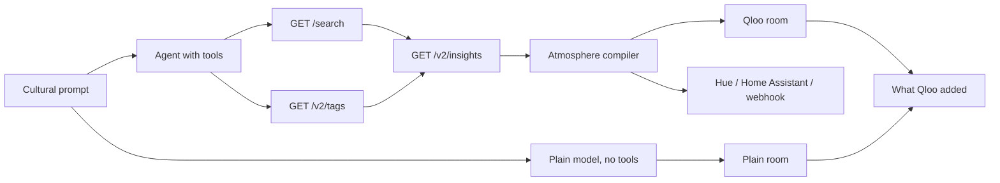

# Atrium

MIT License. See [LICENSE](LICENSE).

Atrium turns a cultural prompt into a room. Qloo's taste graph decides the lamps, the furniture, the poster, and the sound. A second model call, with no Qloo tools, draws the obvious cliché of the same prompt so the difference is visible.

The room is the product. Every light, object, and sound layer cites the Qloo entity or tag that earned it. Tap a lamp and the chip reads like: from Qloo tag "lo-fi" · affinity 0.82 · entity: Nujabes.



On Vercel, Production and Preview have `QLOO_API_KEY` and `OPENAI_API_KEY`. The designed path is the agent (`gpt-4.1-mini` choosing lookups) beside a plain `gpt-4.1-mini` room that never sees Qloo. Locally, with both keys empty, the same page runs a fixed lookup order and a labeled cliché. The badge says **Mock fixture** in that case. It never says the model key is missing.

The compiler is deterministic and validated with zod. The model does not author the room JSON. `compile_atmosphere` runs the compiler on the graph the tools returned.

## Who it is for

Someone setting a room at home, and the same idea for a bar, a restaurant, or a shop floor: name the taste, see the ambiance, then send the lamps to real lights.

## Run it

Node 22 or newer.

```bash
npm install
cp .env.example .env.local
npm run dev
```

Open [http://127.0.0.1:43123](http://127.0.0.1:43123). Leave the keys empty to use the labeled fixture graph. Set `QLOO_API_KEY` for live taste data and `OPENAI_API_KEY` for the agent and the plain-model comparison. `QLOO_MODE=auto` uses live Qloo when the key is present.

```bash
npm test
npm run lint
```

## Environment

| Variable | Required | Purpose |
| --- | --- | --- |
| `QLOO_API_KEY` | For live taste data | Hackathon key. Sent only as the `X-Api-Key` header, server-side. |
| `QLOO_API_URL` | No | Defaults to `https://hackathon.api.qloo.com`. |
| `QLOO_MODE` | No | `auto` (default), `mock`, or `live`. |
| `LLM_PROVIDER` | No | `openai`, `anthropic`, or `gateway`. |
| `LLM_MODEL` | No | Overrides the provider default. |
| `LLM_API_KEY` | No | Fallback key when the provider-specific variable is empty. |
| `OPENAI_API_KEY` | For the agent and the plain comparison | OpenAI. Default model `gpt-4.1-mini`. Set on Vercel Production and Preview. |
| `ANTHROPIC_API_KEY` | No | Anthropic. Default model `claude-sonnet-4-5`. |
| `AI_GATEWAY_API_KEY` | No | Vercel AI Gateway. Default model `openai/gpt-4.1-mini`. |
| `ATMOSPHERE_DISPATCH` | No | `off` (default), `webhook`, `hue`, or `home_assistant`. |
| `ATMOSPHERE_DISPATCH_AUTO` | No | `true` pushes the palette at the end of a compile. |
| `DISPATCH_WEBHOOK_URL` | For webhook | Public URL that accepts `POST` JSON. |
| `HUE_BRIDGE_HOST` | For Hue | Bridge host. Reachable only from the same LAN. |
| `HUE_USERNAME` | For Hue | Hue API username. |
| `HUE_GROUP_ID` | No | Group id, default `0` (all lights). |
| `HA_BASE_URL` | For Home Assistant | Base URL, no trailing path. |
| `HA_TOKEN` | For Home Assistant | Long-lived access token. |
| `HA_ENTITY_ID` | For Home Assistant | Light entity, for example `light.living_room`. |

## What Qloo is asked to do

The client does not call `/recommendations` or `/recs`.

1. `gpt-4.1-mini` names the works and the people (`propose_seeds`). For the sample prompts, and for a Tarantino diner or a Bridgerton tea, canonical names win.
2. `GET /search` confirms those names. A hit is kept only when it is that name. Blade Runner 2049 is not Blade Runner.
3. `GET /v2/tags` resolves the mood and place words to tag ids. Free text is never sent as a tag URN.
4. `GET /v2/insights` runs for artists and for places, with `feature.explainability=true`. Place insights also send `filter.tags` (union) and, for Murakami, `filter.location.query=Tokyo`. Place insights are allowed 15 seconds. Artist insights and search stay on a short budget. A timeout is not retried.

Calls share a queue of two. A 429 waits on `Retry-After` and is not listed unless the retry fails. Successful reads stay in an in-memory cache for 24 hours. The API key is not part of the cache key, and no Qloo payload is committed.

Artists set the tempo. A neighbor stays when it shares an allowlisted genre or mood with the music seeds, such as jazz, piano, ambient, or classical. Literature, pop, and singer-songwriter do not count. If Qloo's explainability says the affinity came from a person rather than the music seed, that neighbor is dropped unless the shared token is on that person. The rank runs after the cache is read, and the debug trace names the token. A short list is kept on purpose. Places set the counter from the room the prompt names: a kitchen looks for a café or tea house, and an onsen only wins when the prompt says bathhouse. A church, a hotel, or a landmark does not pour. One tag is kept per query. Tag names pick a color family. When the kept tags have no color prior, the seeds' own tags (neon, retro, crime) color the lamps. The chip cites that tag. Both rooms use the prompt's time of day. A rainy night reads Night · rain. A dusk prompt reads Dusk.

Auth is `X-Api-Key`. A 401 names the hackathon host. Personal data is not sent. The prompt is a cultural description, not a user profile. Results describe what groups tend to like.

The trace under the room lists each call and why it was made. When the model key is set, the line reads `{model} chose these Qloo calls.`

## Plain reading

The comparison is a second `generateText` with `Output.object` and no tools. It is allowed to be generic: cyan rain, a saxophone, pink symmetry, a cat. The card under the rooms lists names Qloo added that the plain side did not reach, and names both sides landed on.

On a phone, **Atrium** and **Plain LLM** switch the room. A swipe does the same. On a wide screen both rooms stay side by side.

With no model key, that side is a fixed cliché of the words in the prompt, and the note says so. The hosted app has the key, so judges see two model calls.

## A request, redacted

Live response bodies are not stored in the repo. The names below are the ones Preview returned for these prompts. The call shape is the same against `https://hackathon.api.qloo.com`.

```
POST /api/compile
{ "prompt": "Blade Runner meets a 1970s jazz bar" }

GET /search?query=Blade%20Runner&types=urn:entity:movie
GET /search?query=Vangelis&types=urn:entity:artist
GET /v2/tags?filter.query=jazz
GET /v2/insights?filter.type=urn:entity:artist&signal.interests.entities=…
GET /v2/insights?filter.type=urn:entity:place&filter.tags=…&operator.filter.tags=union
```

The room that came back: Blade Runner, Vangelis, a jazz bar (The Low Room on the fixture graph; a jazz bar or lounge on live, not a sky bar), a rye old fashioned, night. The plain reading stayed on cyan rain. The comparison names the bar and the composer in a few large lines. The row list is collapsed.

Other live rooms from the same Preview pass:

- Studio Ghibli bathhouse at dusk: Spirited Away, Joe Hisaishi, a bathhouse counter, hojicha, dusk. Neighbors who only share "film composer" (John Williams, Michael Giacchino) are ranked below artists who share the film's tags.
- a Wes Anderson brunch: The Grand Budapest Hotel, Wes Anderson, Alexandre Desplat, a pastel café, grapefruit spritz, day. No rain.
- reading Murakami on a rainy night: Norwegian Wood, Kafka on the Shore, Bill Evans, a kissaten in Tokyo, a whiskey highball, Night · rain. A singer whose affinity is Murakami, even with a Jazz tag, drops.
- Tarantino road trip diner at 2am: Pulp Fiction, Reservoir Dogs, Quentin Tarantino, Ennio Morricone, an American diner, bottomless coffee, night. Neon, retro, and crime from the films color the lamps amber. The trace should not say a fixture had no aesthetic tag.
- Bridgerton garden tea party: Bridgerton, Pride and Prejudice, Vitamin String Quartet, a tea room, Earl Grey, day. A place named only Gården is dropped. The line on the card is the audience insight: Qloo's Bridgerton fans lean Harry Styles and Olivia Rodrigo, so the pad is a string-quartet take on modern pop.

## Lights

**Send to my real lights** is the bridge from the virtual room to a room you can stand in. Dispatch stays off unless you opt in.

- **Webhook** works from a public deploy. The body is `{ event: "atrium.atmosphere", palette, tempoBpm, title, prompt, lights }`. `lights` is `{ id, label, color, intensity }[]`.
- **Philips Hue** `PUT`s `on`, `bri`, and `xy` to `/api/{username}/groups/{id}/action`. The bridge has to be on the same network as the Next.js server. A Vercel deployment cannot see `192.168.x.x`.
- **Home Assistant** `POST`s `/api/services/light/turn_on` with `rgb_color`. Use a URL the host can reach.

The button always says whether anything was sent. With dispatch off, it returns the payload it would have sent and does not call the network.

## Deploy

The demo is a public Vercel app, with no login.

1. Import the repo as a Next.js project.
2. Set `QLOO_API_KEY`, `QLOO_API_URL=https://hackathon.api.qloo.com`, and `QLOO_MODE=auto` for Production and Preview.
3. Set `OPENAI_API_KEY` for Production and Preview. The default model is `gpt-4.1-mini`.
4. Leave `ATMOSPHERE_DISPATCH=off` unless the target is a public webhook or a public Home Assistant URL.
5. Open a preview, type a prompt or use one of the four examples, and read the trace and the comparison.

`/api/compile` allows 30 requests per 10 minutes per IP, and 150 across everyone on that server instance. The agent and the plain model run in parallel. The route sets `maxDuration` to 60 seconds. The platform may cap a plan lower than that. `/api/dispatch` stays at 12 per 10 minutes per IP. The limiter is in memory, so it applies per instance. A request body cannot choose the webhook, Hue, or Home Assistant address. `QLOO_API_URL` has to be an `https` host under `qloo.com` or the key is not sent.

## Known limits

- The color prior is a table of tag-name stems. A tag with no prior still lights a lamp, and the chip cites the entity or the tag. It does not say the fixture had no aesthetic tag.
- The Qloo cache and the rate limit are in memory, per server instance. A cold start still calls Qloo. It does not fire the calls all at once.
- The plain room is a live model only when a provider key is set. That key is set on Vercel Production and Preview. Local runs without it show the labeled cliché.
- Sound is synthesized in the browser: a pad, a texture (rain, vinyl, water, crowd, air, or steam), and a pulse. No recorded tracks.
- The poster is drawn type. Entity photos are not used as room art.
- Hue is LAN-only. A public demo should use a webhook or a public Home Assistant URL.
- Without `QLOO_API_KEY` the page uses the fixture graph and says **Mock fixture**.
- Do not send personal data. Prompts should describe a taste, not a person.

## Project layout

- `lib/qloo` live client, fixture client, response parsing
- `lib/agent` query splitting, deterministic gather, AI SDK tools, plain-model comparison
- `lib/atmosphere` zod schema, room plans, and the compiler
- `lib/dispatch` Hue, Home Assistant, and webhook
- `app/api/compile`, `app/api/dispatch`, `app/api/status`
- `components` room drawing, WebAudio desk, dossier, comparison
