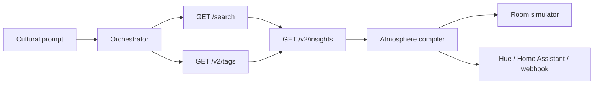

# Atrium

Atrium is a taste-to-atmosphere compiler for the [Qloo Agentic Hackathon](https://qloo.devpost.com/). You type a cultural prompt. The app asks Qloo which artists, places, brands, and books sit next to that taste, then renders the room: palette, generative artwork, a WebAudio texture, and the music, drinks, and objects those affinities justify.

Every color, drink, and object cites the Qloo entity or tag that produced it. If the citation disappeared, the choice would disappear with it.



The orchestrator is the Vercel AI SDK with tool calling when a model key is set. With no model key, the same Qloo client runs in a fixed order: search, tags, then cross-domain insights. The compiler is deterministic and validated with zod, so the same taste graph always prints the same room JSON.

## Run it

Node 22 or newer.

```bash
npm install
cp .env.example .env.local
npm run dev
```

Open [http://127.0.0.1:43123](http://127.0.0.1:43123). Leave `QLOO_API_KEY` empty for the labeled fixture graph. The badge says **Mock data** until a key is present.

```bash
npm test
npm run lint
```

## Environment

| Variable | Required | Purpose |
| --- | --- | --- |
| `QLOO_API_KEY` | For live taste data | Hackathon key. Sent only as the `X-Api-Key` header, server-side. |
| `QLOO_API_URL` | No | Defaults to `https://hackathon.api.qloo.com`. Hackathon keys 401 on `api.qloo.com` and `staging.api.qloo.com`. |
| `QLOO_MODE` | No | `auto` (default), `mock`, or `live`. |
| `LLM_PROVIDER` | No | `openai`, `anthropic`, or `gateway`. |
| `LLM_MODEL` | No | Overrides the provider default. |
| `LLM_API_KEY` | No | Fallback key when the provider-specific variable is empty. |
| `OPENAI_API_KEY` | No | OpenAI. Default model `gpt-4.1-mini`. |
| `ANTHROPIC_API_KEY` | No | Anthropic. Default model `claude-sonnet-4-5`. |
| `AI_GATEWAY_API_KEY` | No | Vercel AI Gateway. Default model `openai/gpt-4.1-mini`. |
| `ATMOSPHERE_DISPATCH` | No | `off` (default), `webhook`, `hue`, or `home_assistant`. |
| `ATMOSPHERE_DISPATCH_AUTO` | No | `true` pushes the palette at the end of a compile. |
| `DISPATCH_WEBHOOK_URL` | For webhook | Public URL that accepts `POST` JSON. |
| `HUE_BRIDGE_HOST` | For Hue | Bridge host. Reachable only from the same LAN. |
| `HUE_USERNAME` | For Hue | Hue API username. |
| `HUE_GROUP_ID` | No | Group id, default `0` (all lights). |
| `HA_BASE_URL` | For Home Assistant | Base URL, no trailing path. |
| `HA_TOKEN` | For Home Assistant | Long-lived access token. |
| `HA_ENTITY_ID` | For Home Assistant | Light entity, for example `light.living_room`. |

Request a Qloo key from the [hackathon developer guide](https://docs.qloo.com/reference/qloo-llm-hackathon-developer-guide). Keys usually arrive by email within a few business days.

## What Qloo is asked to do

The client follows the hackathon guide. It does not call `/recommendations` or `/recs`.

1. `GET /search?query=` resolves names in the prompt to entity ids.
2. `GET /v2/tags?filter.query=` resolves mood words such as "jazz" or "brunch" to tag ids. Free text is never sent as a tag URN.
3. `GET /v2/insights` is called once per domain (`artist`, `place`, `brand`, `book`, `movie`, and `urn:tag`) with `signal.interests.entities`, `signal.interests.tags` when tags resolved, and `feature.explainability=true`.

Parameters are the ones documented for those `filter.type` values. Auth is `X-Api-Key`. A 401 response names the hackathon host, because a valid key on the wrong host is the usual failure.

The dossier lists every call, the seeds, the cross-domain rows, and the affinity or explainability score that justified each choice. Mock rows are marked fixture, and the banner says **MOCK TASTE GRAPH**.

## Lights

Dispatch is off unless you opt in.

- **Webhook** is the one that works from a public deploy. The body is `{ event: "atrium.atmosphere", palette, tempoBpm, title, prompt }`.
- **Philips Hue** `PUT`s `on`, `bri`, and `xy` to `/api/{username}/groups/{id}/action`. The bridge has to be on the same network as the Next.js server. A Vercel deployment cannot see `192.168.x.x`.
- **Home Assistant** `POST`s `/api/services/light/turn_on` with `rgb_color`. Use a URL the host can reach, such as a Nabu Casa webhook or a cloud endpoint, if the demo is public.

"Send this palette" always shows whether anything was dispatched. With dispatch off, it returns the payload it would have sent and does not call the network.

## Deploy for judges

The demo has to be public, with no login. Vercel fits.

1. Push this repo and import it as a Next.js project.
2. Set `QLOO_API_KEY` and `QLOO_API_URL=https://hackathon.api.qloo.com` in the project environment. Leave `QLOO_MODE` at `auto`.
3. Optionally set one model key (`OPENAI_API_KEY`, `ANTHROPIC_API_KEY`, or `AI_GATEWAY_API_KEY`) and `LLM_MODEL` if the default id is not on your account.
4. Leave `ATMOSPHERE_DISPATCH=off` unless you have a **public** webhook or Home Assistant URL. Do not put a LAN Hue address in the hosted project.
5. Deploy. The site should compile a room from a cold visit: type a prompt, or use one of the four examples, and read the taste-graph panel.

`SUBMISSION.md` is the draft for the Devpost form. Put the public URL and this repository on the submission. The license file is MIT.

Without `QLOO_API_KEY` the hosted demo still runs, on purpose, but the badge stays on mock data. Judges should see live Qloo calls, so add the key before you submit.

`/api/compile` allows 12 requests per 10 minutes per IP, and 80 across everyone on that server instance, so a public page cannot drain the Qloo or model quota in one loop. `/api/dispatch` is capped the same way. The limiter is in memory: on Vercel it applies per instance, not across every instance. A request body cannot choose the webhook, Hue, or Home Assistant address. Those come from server environment variables, and `QLOO_API_URL` has to be an `https` host under `qloo.com` or the key is not sent. Dispatch stays off unless you set `ATMOSPHERE_DISPATCH`.

## Project layout

- `lib/qloo` live client, fixture client, response parsing
- `lib/agent` query splitting, deterministic gather, AI SDK tools
- `lib/atmosphere` zod schema and the compiler
- `lib/dispatch` Hue, Home Assistant, and webhook
- `app/api/compile`, `app/api/dispatch`, `app/api/status`
- `components` room, WebAudio desk, dossier
